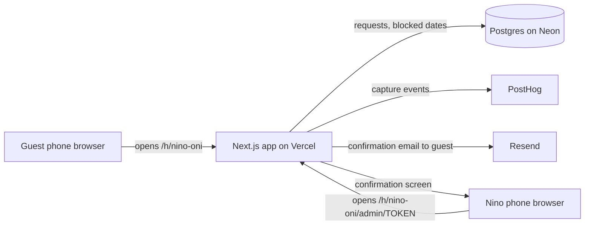

# Architecture

**This is the Sakhli team's file.** Theirs lives at `03-build/architecture/architecture.md`; yours goes to the same path. Copy the shape, not the content.

One diagram, one line of why per layer. The question each line answers is not "is this the best technology" but "can this team deploy it at a public URL by the Week 7 lab."

## The diagram

Two public pages, one private. The host admin page is reachable only through a long random token in the URL, printed on the card we hand Nino. No accounts in Sprint 1.

## The stack, one line per layer

| Layer | Choice | Why we can deploy it by Week 7 |
|---|---|---|
| Hosting | Vercel | GT deployed two class projects on it; free tier; HTTPS and a URL in under ten minutes |
| App framework | Next.js (App Router) | GT and LK both know React; server routes mean no separate backend to host |
| Database | Postgres on Neon | Hosted, free tier, nothing to run; NK has used Postgres at work; two tables and a date-range check is all Sprint 1 needs |
| Analytics | PostHog (wired on the first sprint evening, `setup/SHIP-STACK-SETUP.md`) | fixed for the course |
| Messages out | Resend (email to the guest) | GT owns a domain, verified in Resend in one evening; free tier, one API call. No domain would have cut the email (`setup/messages-out.md`). Host's copy is a screen: Nino does not use email (log 01) |
| Sign-in | None | Host uses a private tokenized link; guests never sign in |

**Layers we deliberately do not have in Sprint 1:** login, file storage (the one house photo is a static file in the repo), background jobs, WhatsApp API (approval takes longer than the sprint).

## The journey through the stack

| Step | Layer that handles it | Event fired |
|---|---|---|
| 1 | Next.js page `/h/[slug]` renders house name, photo, date picker | `guest_opens_host_link` (client, with `source` from the query string) |
| 2 | Form posts to a server route; inserts a `requests` row with status `pending` | `guest_requests_dates` (server) |
| 3 | `/h/[slug]/admin/[token]` lists pending rows; Confirm updates status to `confirmed` | `host_confirms_first_direct_booking` or `host_confirms_repeat_booking` (server, after the update commits) |
| 4 | Same route sends the Resend email to the guest and renders the confirmed state for Nino | `system_sends_confirmation` (server, once per recipient, with `channel`) |
| 5 | Same transaction inserts the date range into `blocked_dates`; the picker reads it | `system_blocks_calendar` (server, with `ms_since_confirm` measured from the confirm timestamp) |

## Secrets and data

- Secrets live in: `.env` (`DATABASE_URL`, `RESEND_API_KEY`, later `NEXT_PUBLIC_POSTHOG_KEY`); `.gitignore` lists `.env`, checked by NK before the first push of `app/`.
- Personal data we store, and where: guest first name and one contact (email or phone) in the `requests` table only; never on an event, never in a log line, never in the repo.
- The one thing in this design most likely to break on deploy day: the date-range overlap check. A request for 14 to 16 August must be rejected once 15 August is blocked, and an off-by-one on the end date lets a double-booking through. This is the first thing we test on the deployed URL in the Week 7 lab, with two overlapping requests.
