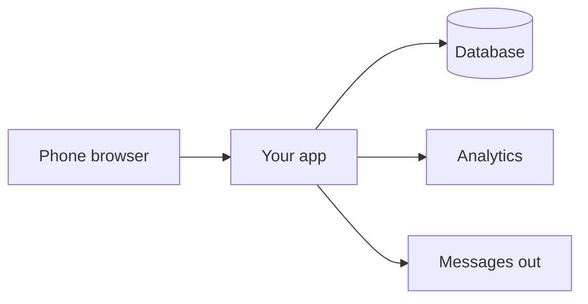

# Architecture

**Save this file as:** `03-build/architecture/architecture.md`
**Filled-in example:** `Lab-6/examples/architecture.md` (Sakhli)

One diagram, one line of why per layer. The question each line answers is not "is this the best technology" but "can this team deploy it at a public URL by the Week 7 lab." The best reason on this page is "someone on this team has deployed this before."

## The diagram

Draw the journey's path through your system: the person's phone, your app, where data is stored, where events go, anything that sends a message. Mermaid here is fine; a whiteboard photo in this folder is fine. One diagram, not three.

## The stack, one line per layer

| Layer | Choice | Why we can deploy it by Week 7 (who has done it before, or the free tier that makes it easy) |
|---|---|---|
| Hosting | | |
| App framework | | |
| Database | | |
| Analytics | PostHog (wired from `setup/SHIP-STACK-SETUP.md`) | fixed for the course |
| Messages out (email, SMS, WhatsApp), if any step needs one | | |
| Sign-in, if any step needs one | | |

**Layers we deliberately do not have in Sprint 1:** [name them; "no login, host uses a private link" is a valid line]

## The journey through the stack

For each step in `03-build/mvp-boundary.md`, which layer does the work, and which event fires there. This is where the boundary, the schema, and the code meet.

| Step | Layer that handles it | Event fired |
|---|---|---|
| 1 | | |
| 2 | | |
| 3 | | |
| 4 | | |
| 5 | | |

## Secrets and data

- Secrets live in: [`.env`, listed in `.gitignore`; confirm it is listed before the first commit of code]
- Personal data we store, and where: [fields, table; a guest's contact detail is in the database and never on an event]
- The one thing in this design most likely to break on deploy day: [name it; this is your first fix in the Week 7 lab]
